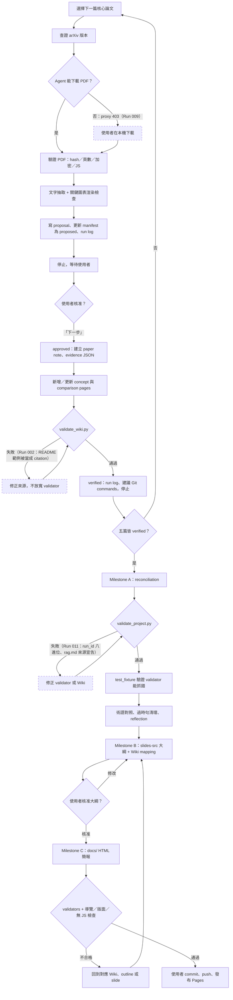

# RAG Paper Wiki workflow

本圖依 `logs/runs/001–011` 的實際執行順序更新（Run 011）。虛線節點是實際發生過的
修正或例外路徑，旁註對應的 run。

## 實際流程

T 之後的節點尚未執行，是預定流程。

## 實際 run 順序

| Run | 操作 | 論文 | 狀態轉移 | 真實 failure |
| --- | --- | --- | --- | --- |
| 001 | proposal | DPR | not_started → proposed | — |
| 002 | ingest | DPR | approved → verified | validator：README 範例 citation |
| 003 | proposal | RAG | not_started → proposed | — |
| 004 | ingest | RAG | approved → verified | —（`rag.md` 來源宣告錯誤在此產生，Run 011 才發現） |
| 005 | proposal | FiD | not_started → proposed | — |
| 006 | ingest | FiD | approved → verified | — |
| 007 | proposal | Self-RAG | not_started → proposed | — |
| 008 | ingest | Self-RAG | approved → verified | — |
| 009 | proposal | RAGChecker | not_started → proposed | 環境：arXiv 被 proxy 擋 |
| 010 | ingest | RAGChecker | approved → verified | —（論文內部不一致 4 項） |
| 011 | reconciliation | 全部 | — | validator bug + Wiki 來源宣告錯誤 |

## 三個主要 loop

1. **Ingest loop**（A → N）：逐篇提案、人工核准、ingest，五篇各跑一次。
2. **Validation loop**（K／P）：失敗時修正來源或 validator，再重跑；從未以放寬規則
   來通過。
3. **Slide review loop**（T → W → X）：尚未執行。

## 責任分工

- **Human**：核准每篇 proposal、大綱與最終成果；本專案中也負責在 agent 無法連線時
  下載 PDF，並自行 commit／push。
- **Agent**：閱讀、摘要、跨論文綜合、教學設計與語意修正。
- **Python validators**：`validate_wiki.py`（evidence、citation、link）、
  `validate_project.py`（manifest、lifecycle、來源宣告、slide mapping）、
  `test_validators.py`（test_fixture，證明 validators 會失敗）。
