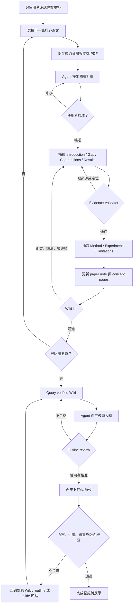

# RAG Paper Wiki workflow

## 完整流程

## 三個主要 loop

1. **Ingest loop**：逐篇提案、人工確認與 ingest，直到五篇皆完成。
2. **Wiki lint loop**：證據缺漏、概念矛盾或連結錯誤時回到原始論文修正。
3. **Slide review loop**：大綱或投影片未通過時重新查詢 Wiki，只重做受影響內容。

## 責任分工

- **Human**：核准每篇閱讀計畫、大綱與最終成果。
- **Agent**：閱讀、摘要、跨論文綜合、教學設計與語意修正。
- **Python validator**：schema、狀態、連結、引用、證據欄位及 slide mapping。

